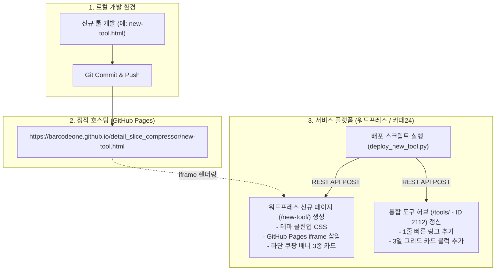

# 🚀 오픈마켓 셀러 도구 추가 & 워드프레스 서비스 배포 완벽 가이드 (SOP)

이 문서는 `detail_slice_compressor` 프로젝트에서 **새로운 클라이언트 사이드 도구를 기획/제작하여 GitHub Pages에 배포하고, 워드프레스(WordPress) 사이트에 연동하며, 쿠팡 파트너스 수익화 및 통합 도구 허브(/tools/)에 등록하는 전 과정**을 설명하는 표준 운영 절차서(Standard Operating Procedure, SOP)입니다.

다른 AI 에이전트나 개발자는 본 문서의 안내와 코드 템플릿을 **그대로 복사하여 사용**함으로써 별도의 시행착오 없이 100% 동일하게 새로운 도구를 배포 및 서비스할 수 있습니다.

---

## 📌 1. 아키텍처 및 시스템 구성 개요



### 핵심 환경 정보
| 항목 | 값 / 설정 | 비고 |
| :--- | :--- | :--- |
| **로컬 워크스페이스** | `d:\4.sourcecode\detail-slice-compressor` | 소스 루트 |
| **GitHub 원격 저장소** | `https://github.com/barcodeone/detail_slice_compressor` | 브랜치: `main` |
| **GitHub Pages Base URL** | `https://barcodeone.github.io/detail_slice_compressor/` | 모든 도구의 iframe 원본 |
| **워드프레스 사이트 URL** | `https://barcode128.mycafe24.com` | 카페24 호스팅 |
| **REST API Base URL** | `https://barcode128.mycafe24.com/wp-json/wp/v2/pages` | 페이지 생성/수정 엔드포인트 |
| **워드프레스 인증** | Basic Auth: `barcode128` / `5CoX aTTH Qzr8 NJzn zLNP xvZW` | REST API용 Application Password |
| **통합 도구 허브 페이지 ID** | `2112` (Slug: `tools`, URL: `/tools/`) | 전체 도구 모음 대시보드 |

---

## ⚠️ 2. 필수 준수 규칙 및 주의사항 (Gotchas & Hard Requirements)

다른 에이전트가 작업 시 **반드시 지켜야 하는 4가지 핵심 원칙**입니다:

1. **카페24 웹방화벽(ModSecurity) 403 Forbidden 방지**
   - 워드프레스 REST API 본문에 `<script>` 태그를 포함하여 전송하면 카페24 WAF가 공격으로 간주하여 `403 Forbidden`을 반환합니다.
   - 따라서 워드프레스 본문에는 **절대 자바스크립트를 넣지 않습니다.**
   - iframe 높이 동적 조절 스크립트 대신, **반응형 CSS 고정 높이(`height: 950px~1150px; scrolling: auto;`)를 사용**합니다.
2. **워드프레스 `wpautop` 자동 개행 버그 방지 (빈 `<p>` 폭탄 차단)**
   - 워드프레스는 HTML 태그 사이의 줄바꿈(`\n`)을 감지하면 자동으로 빈 `<p></p>` 또는 `<br>` 태그를 삽입하여 카드 레이아웃과 CSS 그리드를 완전히 깨뜨립니다.
   - 워드프레스 REST API로 전송하기 전에 **반드시 HTML 태그 간 공백 및 줄바꿈을 정규식으로 압축 제거**해야 합니다.
     ```python
     clean_html = re.sub(r'>\s+<', '><', raw_html.strip())
     clean_html = re.sub(r'[\r\n]+', '', clean_html)
     ```
3. **도구 HTML 내부 광고 중복 배치 금지**
   - 신규 도구 HTML 내부에는 쿠팡 파트너스 배너를 넣지 않습니다. (100% 순수 도구 기능만 구현)
   - 쿠팡 배너는 **워드프레스 페이지의 iframe 바로 아래(최하단)에 딱 1회 단일 섹션으로 카드 3종을 배치**합니다. (내부와 외부에 중복 노출되면 사용자 이탈률이 급증합니다.)
4. **공정거래위원회 필수 문구 명시**
   - 쿠팡 파트너스 카드 하단에는 반드시 다음 문구를 포함해야 합니다:
     `이 포스팅은 쿠팡 파트너스 활동의 일환으로 이에 따른 일정액의 수수료를 제공받습니다.`

---

## 🛠️ 3. 단계별 전과정 작업 절차 (Step-by-Step Pipeline)

### [Step 1] 신규 도구 HTML 제작 (클라이언트 사이드 SPA)
1. 파일명 규격: 영문 소문자 케밥 케이스 (예: `delivery-fee.html`, `watermark.html`, `gif-maker.html`).
2. **[중요] 파일 저장 위치**: GitHub Pages 배포 워크플로우는 `public/` 폴더를 기준으로 배포되므로, 신규 HTML 파일은 **반드시 `public/` 디렉토리 내부(및 루트)에 생성/복사**해야 합니다! (예: `public/gif-maker.html`)
3. 모든 연산과 처리는 외부 서버 전송 없이 **브라우저 내(HTML5 Canvas, File API, Web Crypto, JSZip 등)**에서 완결되어야 합니다.
4. 디자인 스타일 가이드:
   - 폰트: `Pretendard`, `-apple-system`, `sans-serif`
   - 모던하고 깔끔한 대시보드 카드 스타일 (`background: #ffffff; border: 1px solid #e2e8f0; border-radius: 16px;`)
   - 메인 포인트 컬러: 인디고/블루 계열 (`#4f46e5`, `#2563eb`)

### [Step 2] 로컬 테스트 및 Git Push (GitHub Pages 반영)
1. 로컬 브라우저에서 HTML 파일을 직접 열어 모든 버튼, 입력 폼, 다운로드 기능이 정상 작동하는지 확인합니다.
2. Git을 통해 `main` 브랜치에 푸시합니다:
   ```powershell
   git add .
   git commit -m "feat: Add new tool {도구명}"
   git push origin main
   ```
3. GitHub Pages 주소(`https://barcodeone.github.io/detail_slice_compressor/{파일명}.html`)에 브라우저로 접속하여 정상 표시되는지 확인합니다.

### [Step 3] 쿠팡 파트너스 배너 3종 링크 준비
1. 도구의 타겟 사용자가 구매할 만한 관련 실물 상품 3개를 선정합니다. (예: 저울, 라벨프린터, 듀얼모니터암, 넘버패드 등)
2. 각 상품의 쿠팡 파트너스 HTML 배너 태그(`<a></a>`)를 준비합니다:
   - 상품 단축 링크 (`https://link.coupang.com/a/...`)
   - 240×120 규격 이미지 URL (`https://image...coupangcdn.com/...@2x.jpg`)
   - 상품 타이틀 및 핵심 혜택 태그

### [Step 4] 워드프레스 페이지 자동 등록 (파이썬 배포 스크립트 실행)
워드프레스 REST API를 호출하여 신규 페이지를 `publish` 상태로 등록합니다.
아래의 [4.1 워드프레스 신규 도구 배포 템플릿](#41-신규-도구-페이지-배포-스크립트-템플릿-deploy_toolpy) 코드를 활용합니다.

### [Step 5] 통합 도구 허브 (`/tools/`) 대시보드 동기화
1. `update_tools_hub_9.py`를 열어 신규 도구 항목을 추가합니다.
   - 상단 빠른 링크 (`.hub-quick-list`)에 1줄 추가
   - 하단 그리드 (`.tools-card-grid`)에 신규 도구 카드 블럭 추가
2. 스크립트를 실행하여 Page ID `2112`를 즉시 갱신합니다.

### [Step 6] 배포 완료 검증 (Checklist)
- [ ] 워드프레스 도구 URL (`https://barcode128.mycafe24.com/{slug}/`) 접속 정상 확인
- [ ] 본문 iframe에 GitHub Pages 도구가 공백이나 잘림 없이 꽉 차게 렌더링되는지 확인
- [ ] 최하단 쿠팡 배너 카드 3종 이미지 노출 및 클릭 시 쿠팡 링크 정상 이동 확인
- [ ] 통합 도구 허브 (`https://barcode128.mycafe24.com/tools/`)에서 신규 도구 링크 클릭 시 정상 연결 확인

---

## 💻 4. 재사용 가능한 표준 코드 템플릿

### 4.1 신규 도구 페이지 배포 스크립트 템플릿 (`deploy_tool.py`)
새 도구를 워드프레스에 등록할 때 변수(`TOOL_SLUG`, `TOOL_TITLE`, `IFRAME_HEIGHT`, 쿠팡 배너 정보)만 수정하여 실행하면 됩니다.

```python
import requests
import base64
import re

# 1. 카페24 워드프레스 인증 설정
auth = base64.b64encode(b'barcode128:5CoX aTTH Qzr8 NJzn zLNP xvZW').decode()
headers = {
    'Authorization': 'Basic ' + auth,
    'Content-Type': 'application/json'
}
wp_base = "https://barcode128.mycafe24.com/wp-json/wp/v2/pages"

# 2. 도구 메타 정보 설정
TOOL_SLUG = "my-new-tool"  # URL 슬러그 (예: /my-new-tool/)
TOOL_TITLE = "스마트스토어·쿠팡 신규 자동화 툴 | Barcode128"
IFRAME_URL = f"https://barcodeone.github.io/detail_slice_compressor/{TOOL_SLUG}.html"
IFRAME_HEIGHT = "1050px"  # 도구 높이에 맞게 조절 (보통 950px ~ 1150px)

# 3. 워드프레스 본문 HTML 구성
raw_content = f"""<!-- wp:html -->
<style>
/* 테마 레이아웃 클린업 (사이드바 제거 및 컨테이너 100% 확장) */
#left-sidebar, #right-sidebar {{ display: none !important; }}
#primary.content-area, .site-content .content-area {{ width: 100% !important; max-width: 100% !important; float: none !important; }}
.grid-container {{ max-width: 1280px !important; }}
.inside-article {{ padding: 10px 16px !important; }}
.entry-header {{ display: none !important; }}
</style>

<div style="width:100%; max-width:1200px; margin:0 auto; padding-bottom:50px; font-family:'Pretendard', sans-serif;">
    <!-- 1) 도구 Iframe 삽입 (ModSecurity 방화벽 회피를 위해 JS 리사이저 대신 CSS 고정 높이 사용) -->
    <iframe src="{IFRAME_URL}" style="width:100%; height:{IFRAME_HEIGHT}; border:none; border-radius:20px; box-shadow:0 4px 20px rgba(0,0,0,0.06); margin-bottom:40px; display:block;" scrolling="auto"></iframe>

    <!-- 2) 하단 단일 추천 쿠팡 파트너스 배너 섹션 (3개 아이템 그리드) -->
    <div style="background:#f8fafc; border:1px solid #e2e8f0; border-radius:24px; padding:32px; margin-top:30px;">
        <div style="margin-bottom:24px;">
            <span style="font-size:12px; font-weight:800; color:#4f46e5; text-transform:uppercase; letter-spacing:0.5px;">SELLER RECOMMENDATION</span>
            <h3 style="font-size:20px; font-weight:900; color:#0f172a; margin:4px 0 6px 0;">⚡ 오픈마켓 셀러 추천 장비 &amp; 필수 아이템 3종</h3>
            <p style="font-size:13px; color:#64748b; margin:0;">업무 효율성과 작업 생산성을 극대화해주는 셀러 맞춤 추천 장비입니다.</p>
        </div>

        <div style="display:grid; grid-template-columns:repeat(auto-fit, minmax(280px, 1fr)); gap:20px;">
            <!-- 아이템 1 -->
            <div style="background:#ffffff; border:1px solid #e2e8f0; border-radius:18px; padding:22px; display:flex; flex-direction:column; justify-content:space-between; box-shadow:0 2px 4px rgba(0,0,0,0.02);">
                <div>
                    <div style="display:flex; justify-content:center; align-items:center; height:240px; margin-bottom:14px; background:#fafafa; border-radius:12px; overflow:hidden;">
                        <a href="https://link.coupang.com/a/아이템1링크" target="_blank" referrerpolicy="unsafe-url">
                            
                        </a>
                    </div>
                    <span style="font-size:11px; font-weight:700; background:#eef2ff; color:#4338ca; padding:3px 8px; border-radius:6px; display:inline-block; margin-bottom:8px;">추천 태그 1</span>
                    <h4 style="font-size:15px; font-weight:800; color:#0f172a; margin:0 0 6px 0; line-height:1.4;">추천 상품 1 타이틀</h4>
                    <p style="font-size:12.5px; color:#64748b; margin:0; line-height:1.5;">상품에 대한 한 줄 설명 및 셀러에게 필요한 이유</p>
                </div>
                <div style="margin-top:16px; padding-top:12px; border-top:1px solid #f1f5f9; display:flex; justify-content:space-between; align-items:center;">
                    <span style="font-size:11.5px; font-weight:700; color:#0f172a;">로켓배송</span>
                    <a href="https://link.coupang.com/a/아이템1링크" target="_blank" referrerpolicy="unsafe-url" style="padding:7px 14px; background:#0f172a; color:#ffffff; font-size:12px; font-weight:700; border-radius:8px; text-decoration:none;">상품 보기 ➔</a>
                </div>
            </div>

            <!-- 아이템 2 -->
            <div style="background:#ffffff; border:1px solid #e2e8f0; border-radius:18px; padding:22px; display:flex; flex-direction:column; justify-content:space-between; box-shadow:0 2px 4px rgba(0,0,0,0.02);">
                <div>
                    <div style="display:flex; justify-content:center; align-items:center; height:240px; margin-bottom:14px; background:#fafafa; border-radius:12px; overflow:hidden;">
                        <a href="https://link.coupang.com/a/아이템2링크" target="_blank" referrerpolicy="unsafe-url">
                            
                        </a>
                    </div>
                    <span style="font-size:11px; font-weight:700; background:#fef3c7; color:#b45309; padding:3px 8px; border-radius:6px; display:inline-block; margin-bottom:8px;">추천 태그 2</span>
                    <h4 style="font-size:15px; font-weight:800; color:#0f172a; margin:0 0 6px 0; line-height:1.4;">추천 상품 2 타이틀</h4>
                    <p style="font-size:12.5px; color:#64748b; margin:0; line-height:1.5;">상품에 대한 한 줄 설명</p>
                </div>
                <div style="margin-top:16px; padding-top:12px; border-top:1px solid #f1f5f9; display:flex; justify-content:space-between; align-items:center;">
                    <span style="font-size:11.5px; font-weight:700; color:#0f172a;">무료배송</span>
                    <a href="https://link.coupang.com/a/아이템2링크" target="_blank" referrerpolicy="unsafe-url" style="padding:7px 14px; background:#0f172a; color:#ffffff; font-size:12px; font-weight:700; border-radius:8px; text-decoration:none;">상품 보기 ➔</a>
                </div>
            </div>

            <!-- 아이템 3 -->
            <div style="background:#ffffff; border:1px solid #e2e8f0; border-radius:18px; padding:22px; display:flex; flex-direction:column; justify-content:space-between; box-shadow:0 2px 4px rgba(0,0,0,0.02);">
                <div>
                    <div style="display:flex; justify-content:center; align-items:center; height:240px; margin-bottom:14px; background:#fafafa; border-radius:12px; overflow:hidden;">
                        <a href="https://link.coupang.com/a/아이템3링크" target="_blank" referrerpolicy="unsafe-url">
                            
                        </a>
                    </div>
                    <span style="font-size:11px; font-weight:700; background:#ecfdf5; color:#047857; padding:3px 8px; border-radius:6px; display:inline-block; margin-bottom:8px;">추천 태그 3</span>
                    <h4 style="font-size:15px; font-weight:800; color:#0f172a; margin:0 0 6px 0; line-height:1.4;">추천 상품 3 타이틀</h4>
                    <p style="font-size:12.5px; color:#64748b; margin:0; line-height:1.5;">상품에 대한 한 줄 설명</p>
                </div>
                <div style="margin-top:16px; padding-top:12px; border-top:1px solid #f1f5f9; display:flex; justify-content:space-between; align-items:center;">
                    <span style="font-size:11.5px; font-weight:700; color:#0f172a;">가성비 최고</span>
                    <a href="https://link.coupang.com/a/아이템3링크" target="_blank" referrerpolicy="unsafe-url" style="padding:7px 14px; background:#0f172a; color:#ffffff; font-size:12px; font-weight:700; border-radius:8px; text-decoration:none;">상품 보기 ➔</a>
                </div>
            </div>
        </div>

        <!-- 3) 공정위 필수 문구 -->
        <p style="text-align:center; font-size:11px; color:#94a3b8; margin:24px 0 0 0;">이 포스팅은 쿠팡 파트너스 활동의 일환으로 이에 따른 일정액의 수수료를 제공받습니다.</p>
    </div>
</div>
<!-- /wp:html -->"""

# 4. [중요] wpautop 자동 빈 <p> 태그 방지를 위한 개행/공백 압축 처리
def clean_html(h):
    h = re.sub(r'>\s+<', '><', h.strip())
    h = re.sub(r'[\r\n]+', '', h)
    return h

clean_content = clean_html(raw_content)

# 5. 기존 페이지 존재 여부 확인 후 신규 생성 또는 업데이트
chk_res = requests.get(f"{wp_base}?slug={TOOL_SLUG}", headers=headers)
existing_pages = chk_res.json() if chk_res.status_code == 200 else []

if existing_pages:
    page_id = existing_pages[0]["id"]
    res = requests.post(f"{wp_base}/{page_id}", headers=headers, json={
        "title": TOOL_TITLE,
        "content": clean_content
    })
    print(f"✅ [수정 완료] 기존 페이지 갱신 성공 - ID: {page_id}, Status: {res.status_code}")
else:
    res = requests.post(wp_base, headers=headers, json={
        "title": TOOL_TITLE,
        "content": clean_content,
        "slug": TOOL_SLUG,
        "status": "publish"
    })
    print(f"🎉 [신규 생성 완료] 새 페이지 발행 성공 - Status: {res.status_code}, New ID: {res.json().get('id')}")
```

---

### 4.2 통합 도구 허브 (`/tools/`) 등록 가이드

통합 도구 허브는 워드프레스 Page ID `2112`에 위치합니다.
신규 도구가 추가되면 허브 페이지의 상단 1줄 리스트와 하단 3열 카드 블럭에 항목을 추가하고 `update_tools_hub_9.py`의 구조를 그대로 활용하여 업데이트합니다.

#### A. 상단 빠른 링크 아이템 템플릿
```html
<li class="hub-quick-item">
    <a href="https://barcode128.mycafe24.com/{slug}/" class="hub-quick-link">
        <span class="hub-quick-num">{번호}.</span>
        <span class="hub-quick-name">{도구 이름}</span>
        <span class="hub-quick-desc">– {한 줄 요약 설명}</span>
        <span class="hub-quick-arrow">바로가기 ➔</span>
    </a>
</li>
```

#### B. 하단 3열 카드 블럭 템플릿
```html
<a href="https://barcode128.mycafe24.com/{slug}/" class="tool-card">
    <div class="tool-card-head">
        <div class="tool-card-icon" style="background:#eef2ff; color:#4f46e5;">{아이콘(예: 📊, ⚡)}</div>
        <span class="tool-card-badge" style="background:#eef2ff; color:#4338ca;">{카테고리 뱃지}</span>
    </div>
    <h3 class="tool-card-title">{도구 타이틀}</h3>
    <p class="tool-card-desc">{도구 핵심 기능 및 사용자 효용에 대한 2~3줄 설명}</p>
    <div class="tool-card-action">
        <span>무료 도구 열기</span>
        <span class="tool-card-arrow">➔</span>
    </div>
</a>
```

---

## 📋 5. 기존 운영 중인 9대 도구 목록 및 메타 레퍼런스

참고를 위해 현재 서비스 중인 9개 도구의 정보입니다:

| No | 도구명 | Slug | 워드프레스 ID | GitHub Pages 원본 파일 |
| :---: | :--- | :--- | :---: | :--- |
| **1** | 상세페이지 분할 & 초경량 WebP 압축기 | `detail-slice-compressor` | `2086` | `index.html` |
| **2** | 오픈마켓 썸네일 정방형(1:1) 패딩 & 누끼 변환기 | `thumbnail-square` | `2091` | `thumbnail.html` |
| **3** | Code 128 바코드 & QR코드 일괄 생성기 | `barcode-generator` | `2104` | `barcode.html` |
| **4** | 오픈마켓 판매 마진율 & 역마진 계산기 | `margin-calculator` | `2105` | `margin.html` |
| **5** | 상세페이지 OCR 텍스트 & 태그 키워드 추출기 | `ocr-keyword-extractor` | `2106` | `ocr-keyword.html` |
| **6** | 50자 상품명 조합기 & 금지단어 필터기 | `title-combiner` | `2107` | `title-combiner.html` |
| **7** | 오픈마켓 부가세(VAT) & 실납부세액 계산기 | `vat-calculator` | `2119` | `vat-calculator.html` |
| **8** | 상세페이지·썸네일 이미지 워터마크 자동 삽입기 | `watermark` | `2120` | `watermark.html` |
| **9** | 스마트스토어 vs 쿠팡 채널별 수수료 & 마진 비교기 | `channel-compare` | `2121` | `channel-compare.html` |
| **10** | 동영상 ➔ 초경량 고화질 GIF 움짤 생성기 | `gif-maker` | `2128` | `gif-maker.html` |
| **Hub** | **전체 오픈마켓 셀러 통합 툴 모음 허브** | `tools` | `2112` | - |

---

## 🎯 6. 요약 요령

다른 에이전트가 새 툴을 추가할 때는 아래 3단계 명령만 차례로 실행하면 됩니다:
1. `git add {새툴}.html; git commit -m "feat: Add ..."; git push origin main`
2. `deploy_tool.py` 복사 후 슬러그/제목/쿠팡링크 채워 넣고 `python deploy_tool.py` 실행
3. `update_tools_hub_9.py`에 새 툴 항목 추가 후 `python update_tools_hub_9.py` 실행
